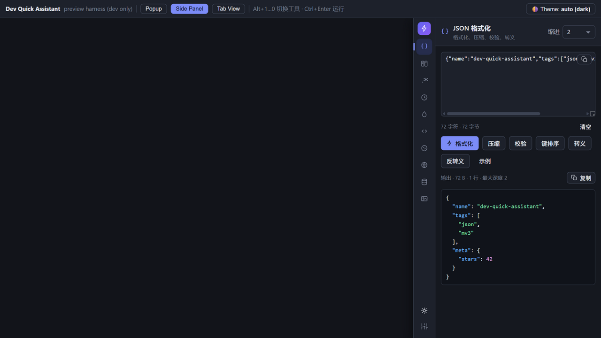
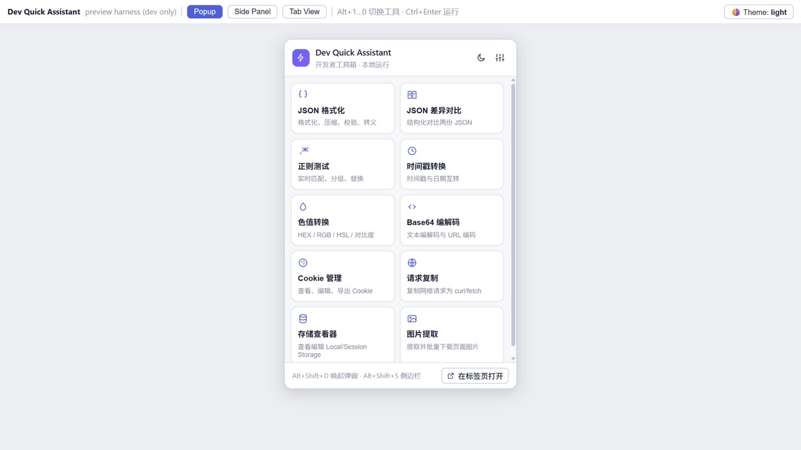
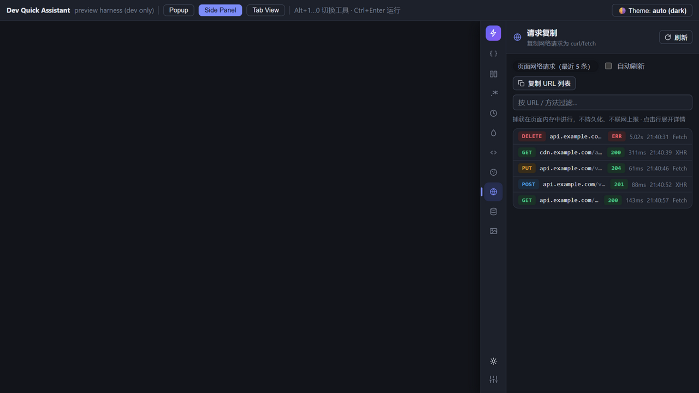
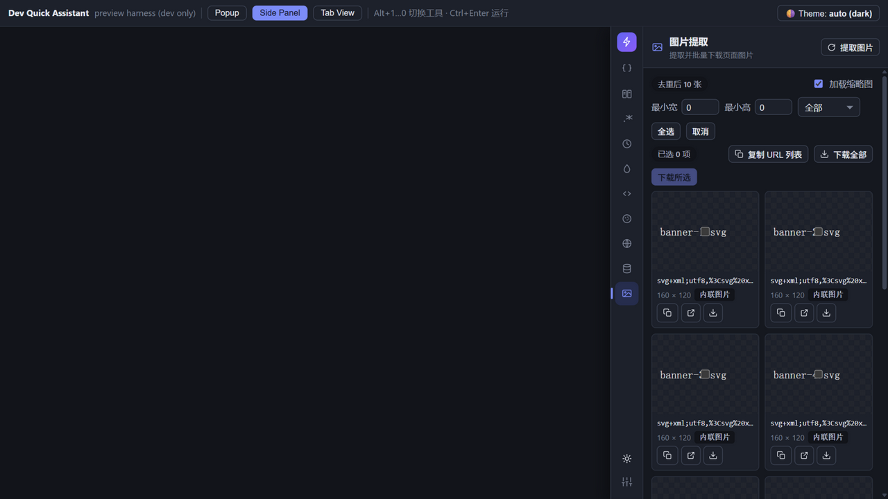

<div align="center">

# ⚡ Dev Quick Assistant

**All-in-one developer toolbox for Chrome / Edge (Manifest V3) — 100% local, zero network.**

[](./.github/workflows/build.yml)
[](./LICENSE)
[](./public/manifest.json)
[](.)

*中文说明见 [README.zh-CN.md](./README.zh-CN.md)*

</div>

---

Dev Quick Assistant is a browser-extension toolbox that puts the nine tools web developers open every day into a popup and a side panel. **Every byte of computation happens in your browser** — no backend, no telemetry, no remote endpoints, nothing uploaded. Ever.

## ✨ Tools

| Tool | What it does |
| --- | --- |
| **JSON Formatter** | Format / minify / validate / sort keys / escape–unescape, syntax highlighting, error position (line:col), depth & size stats |
| **JSON Diff** | Structural diff (added / removed / changed per JSON path) + line-level side-by-side view, node budget for huge payloads |
| **Regex Tester** | Live matching with highlight, capture & named groups, replace preview, presets — runs in a **Web Worker with 3s timeout** so catastrophic backtracking can't freeze the UI |
| **Timestamp** | Timestamp ⇄ date with timezone support (DST-safe), batch extraction of 10/13-digit stamps from any text, live clock |
| **Color** | HEX / RGB / HSL / HSV / RGBA / HSLA conversions, alpha, WCAG contrast checker, 10-step shade scale, named colors |
| **Base64 / URL** | UTF-8-safe encode & decode, URL-safe alphabet, strict validation with error positions, URL codec |
| **Cookie Manager** | View / search / edit / delete cookies of the current site, export JSON · Netscape (curl-compatible) · request header, import JSON |
| **Request Copy** | Captures the page's fetch/XHR traffic in a memory ring buffer, then copies any request as **cURL / fetch / JSON** |
| **Storage Viewer** | Inspect & edit `localStorage` / `sessionStorage` of the active tab, sizes, search, export |
| **Image Extractor** | Harvest page images (img / CSS backgrounds / favicons), filter by size & type, batch download |

## 📸 Screenshots

| Side panel (dark) | Popup (light) |
| --- | --- |
|  |  |

| Request copy | Image extractor |
| --- | --- |
|  |  |

## 🔒 Privacy by construction

- **No network access from the extension itself.** All conversions run locally; the only network activity you may see is the browser loading image *thumbnails* in the Image Extractor (directly from the site you are already on — toggleable).
- Captured requests / storage values / cookies live **in memory only** and vanish when the tab closes.
- The only persisted state is your UI preference (theme, language, indent), stored in `chrome.storage.sync`.
- Source is small and readable — audit it yourself.

## 📥 Install

### From a release zip (Chrome & Edge)

1. Grab `dev-quick-assistant-v*.zip` from [Releases](../../releases) (CI builds it on every tag).
2. Unzip it.
3. Chrome: open `chrome://extensions` → enable **Developer mode** (top right) → **Load unpacked** → select the unzipped folder.
4. Edge: open `edge://extensions` → enable **Developer mode** (left sidebar) → **Load unpacked**.
5. Pin the icon, press `Alt+Shift+D` to open the popup or `Alt+Shift+S` for the side panel.

### From source

```bash
git clone https://github.com/your-name/dev-quick-assistant.git
cd dev-quick-assistant
npm install
npm run zip        # -> release/dev-quick-assistant-v1.0.0.zip + dist/
```

Then load `dist/` as above.

### Developing

`npm run dev` starts a preview harness at `http://localhost:5173/preview.html` — every tool runs in a plain browser tab with chrome APIs mocked, no extension loading required. See [CONTRIBUTING.md](./CONTRIBUTING.md).

## ⌨️ Shortcuts

| Shortcut | Scope | Action |
| --- | --- | --- |
| `Alt+Shift+D` | Global | Open popup |
| `Alt+Shift+S` | Global | Open side panel |
| `Alt+1 … Alt+9`, `Alt+0` | Inside extension pages | Jump to tool N |
| `Alt+↑ / Alt+↓` | Inside extension pages | Previous / next tool |
| `Ctrl/⌘+Enter` | Inside extension pages | Run active tool's main action |

Global shortcuts can be remapped at `chrome://extensions/shortcuts`.

## 🧩 Permissions & why

| Permission | Reason |
| --- | --- |
| `storage` | Save UI preferences (theme/language/indent) |
| `cookies` | Cookie manager tool |
| `scripting` | Read page storage / images on demand (ISOLATED world collectors) |
| `downloads` | Export images & files |
| `sidePanel` | Side panel UI |
| Host `http/https` | Inject the request-capture hook at `document_start` and let page tools work on any site you open |

No `<all_urls>` beyond http/https, no `tabs`, no `debugger`, no `webRequest`.

## 🛠 Tech stack

- **Vue 3** (`<script setup>`) + **Vite 5** — zero runtime dependencies besides Vue
- Manifest V3, service worker (module), dual-world content scripts (`MAIN` hook + `ISOLATED` bridge)
- Request hook wraps `fetch` / `XMLHttpRequest` at `document_start` in a page-memory ring buffer; the popup reads it through `chrome.runtime` messaging — the hook never breaks the page (every path try/catch'd)
- Regex runs in a dedicated Worker with hard timeout & terminate
- Vitest suite (165 tests) covering huge JSON (2 MB+), invalid regexes, 1 MB Base64 strings, deep nesting, DST timezone math…
- Zero-dep build extras: PNG icon generator, ZIP packer (`scripts/`)
- Light/dark theme with auto detection, zh/en i18n

```
npm test     # 165 tests
npm run zip  # dist/ (371 KB) -> release zip (~109 KB)
```

## 🗺 Roadmap

- [ ] JSONPath / jq-like query for JSON tool
- [ ] `curl` → fetch reverse parser
- [ ] Request body pretty-viewers (JSON / form)
- [ ] Optional per-site permission mode instead of broad host access
- [ ] Firefox (MV3) port

## 🤝 Contributing

PRs welcome! Read [CONTRIBUTING.md](./CONTRIBUTING.md) for the dev workflow, the "add a new tool" checklist and the hard no-network rule. Use the [issue templates](.github/ISSUE_TEMPLATE/).

## 📄 License

[MIT](./LICENSE) © dev-quick-assistant contributors
