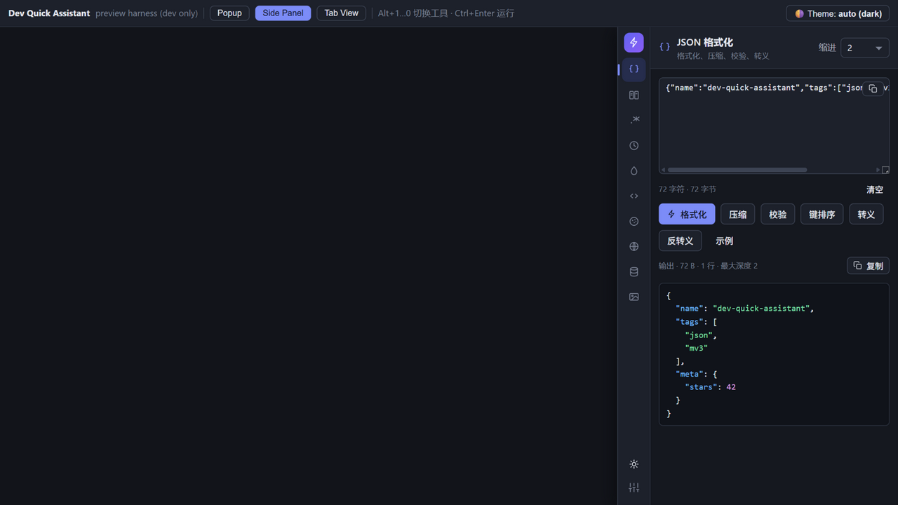
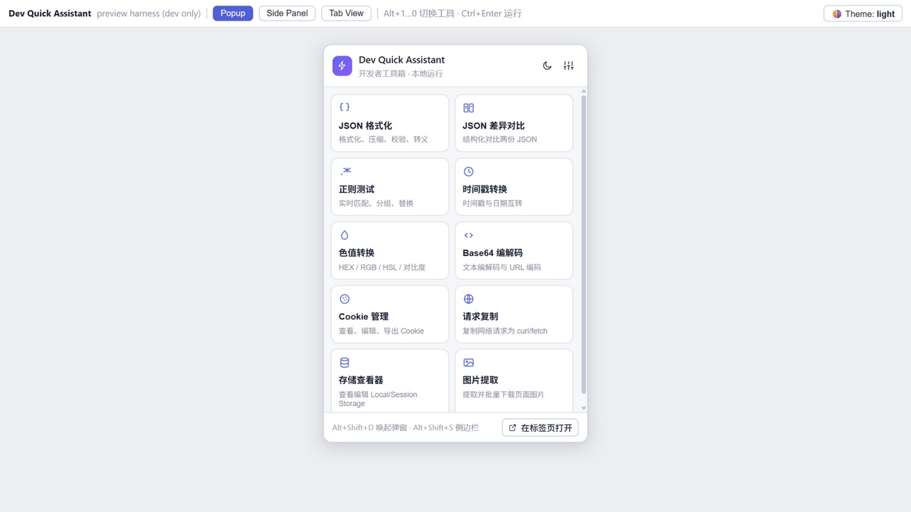
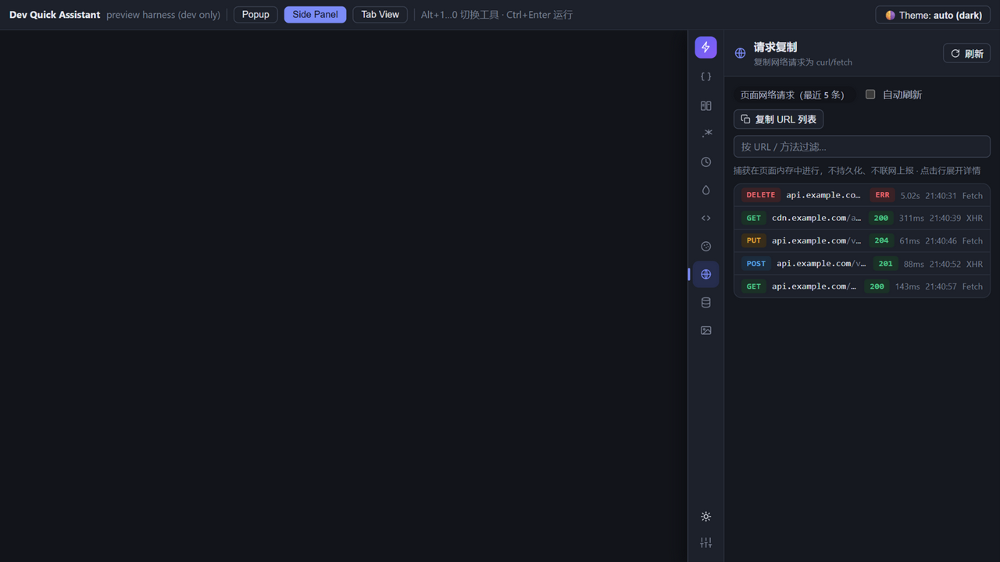
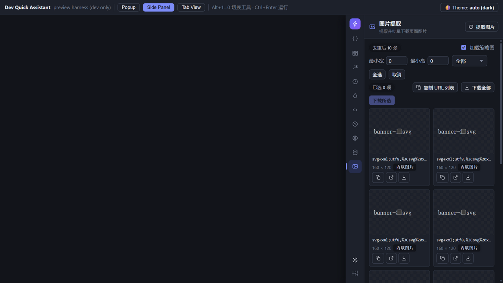

<div align="center">

# ⚡ 开发助手 Dev Quick Assistant

**Chrome / Edge (Manifest V3) 一体化开发者工具箱 —— 100% 本地运行，零网络上报。**

[](./.github/workflows/build.yml)
[](./LICENSE)
[](./public/manifest.json)
[](.)

*[English](./README.md) | 中文*

</div>

---

开发助手把前端/后端同学每天都在用的九类小工具装进浏览器弹窗与侧边栏。**所有计算全部在浏览器本地完成** —— 无后端、无远程接口、无统计上报、不上传任何数据。

## ✨ 功能一览

| 工具 | 能力 |
| --- | --- |
| **JSON 格式化** | 格式化 / 压缩 / 校验 / 键排序 / 转义与反转义，语法高亮，错误定位到行列，体积与深度统计 |
| **JSON 差异对比** | 结构化差异（按 JSON 路径列出新增/删除/修改）+ 行级左右对照视图，超大文本有节点预算保护 |
| **正则测试** | 实时匹配高亮、捕获组与命名分组、替换预览、常用模板 —— 在 **Web Worker 中执行并带 3 秒超时**，灾难性回溯也卡不死界面 |
| **时间戳转换** | 时间戳 ⇄ 日期，支持多时区（DST 安全）、从任意文本批量提取 10/13 位时间戳、实时时钟 |
| **色值转换** | HEX / RGB / HSL / HSV / RGBA / HSLA 互转、透明度、WCAG 对比度检查、10 级明暗色阶、CSS 命名色 |
| **Base64 / URL** | UTF-8 安全编解码、URL 安全字母表、严格校验并报出错误位置、URL 编解码 |
| **Cookie 管理** | 查看 / 搜索 / 编辑 / 删除当前站点 Cookie，导出 JSON · Netscape（curl 兼容）· 请求头，JSON 导入 |
| **请求复制** | 在页面内存环形缓冲中捕获 fetch/XHR 流量，任意请求一键复制为 **cURL / fetch / JSON** |
| **存储查看器** | 查看并编辑当前标签页的 `localStorage` / `sessionStorage`，大小统计、搜索、导出 |
| **图片提取** | 抓取页面图片（img / CSS 背景 / 站点图标），按尺寸与类型筛选，批量下载 |

## 📸 界面预览

| 侧边栏（深色） | 弹窗（浅色） |
| --- | --- |
|  |  |

| 请求复制 | 图片提取 |
| --- | --- |
|  |  |

## 🔒 隐私是架构决定的

- **扩展自身不发起任何网络请求**。全部转换本地完成；唯一可能出现的网络活动是图片提取器的缩略图（由浏览器直接向你正在浏览的站点加载，可一键关闭）。
- 捕获的请求 / 存储值 / Cookie **只驻留内存**，标签页关闭即释放。
- 唯一持久化的是界面偏好（主题、语言、缩进），存在 `chrome.storage.sync`。
- 代码量小、可读性高 —— 欢迎自行审计。

## 📥 安装

### 从 Release 压缩包（Chrome & Edge）

1. 到 [Releases](../../releases) 下载 `dev-quick-assistant-v*.zip`（CI 在每个 tag 自动打包）。
2. 解压。
3. Chrome：打开 `chrome://extensions` → 右上角开启「开发者模式」→「加载已解压的扩展程序」→ 选择解压后的文件夹。
4. Edge：打开 `edge://extensions` → 左侧开启「开发人员模式」→「加载解压缩的扩展」。
5. 固定图标后，`Alt+Shift+D` 打开弹窗，`Alt+Shift+S` 打开侧边栏。

### 从源码构建

```bash
git clone https://github.com/dengliziyue/dev-quick-assistant.git
cd dev-quick-assistant
npm install
npm run zip        # -> release/dev-quick-assistant-v1.0.0.zip + dist/
```

然后按上面方式加载 `dist/`。

### 本地开发

`npm run dev` 启动开发预览台 `http://localhost:5173/preview.html` —— 所有工具在普通浏览器标签页中运行，chrome API 由 mock 提供，无需加载扩展。详见 [CONTRIBUTING.md](./CONTRIBUTING.md)。

## ⌨️ 快捷键

| 快捷键 | 作用域 | 功能 |
| --- | --- | --- |
| `Alt+Shift+D` | 全局 | 打开弹窗 |
| `Alt+Shift+S` | 全局 | 打开侧边栏 |
| `Alt+1 … Alt+9`、`Alt+0` | 扩展页面内 | 切换到第 N 个工具 |
| `Alt+↑ / Alt+↓` | 扩展页面内 | 上一个 / 下一个工具 |
| `Ctrl/⌘+Enter` | 扩展页面内 | 执行当前工具主操作 |

全局快捷键可在 `chrome://extensions/shortcuts` 中修改。

## 🧩 权限说明

| 权限 | 用途 |
| --- | --- |
| `storage` | 保存界面偏好（主题/语言/缩进） |
| `cookies` | Cookie 管理工具 |
| `scripting` | 按需读取页面存储 / 图片（ISOLATED world 收集器） |
| `downloads` | 导出图片与文件 |
| `sidePanel` | 侧边栏界面 |
| 主机权限（http/https） | 在 `document_start` 注入请求捕获钩子，并让页面工具在你打开的任意站点工作 |

未使用 `tabs`、`debugger`、`webRequest`，主机权限仅限 http/https。

## 🛠 技术栈

- **Vue 3**（`<script setup>`）+ **Vite 5** —— 运行时依赖只有 Vue
- Manifest V3：module Service Worker + 双世界内容脚本（`MAIN` world 钩子 + `ISOLATED` world 桥接）
- 请求钩子在 `document_start` 包装 `fetch` / `XMLHttpRequest`，环形缓冲存在页面内存；弹窗经 `chrome.runtime` 消息读取 —— 钩子全路径 try/catch，绝不影响页面本身
- 正则在独立 Worker 中执行，硬超时 + terminate
- Vitest 测试 165 条，覆盖超大 JSON（2 MB+）、非法正则、1 MB Base64、超深嵌套、夏令时时区换算……
- 零依赖构建脚本：PNG 图标生成器、ZIP 打包器（`scripts/`）
- 明暗双主题（跟随系统 + 手动切换）、中英双语

```
npm test     # 165 个测试
npm run zip  # dist/ (371 KB) -> release zip (~109 KB)
```

## 🗺 路线图

- [ ] JSON 工具支持 JSONPath / jq 风格查询
- [ ] `curl` → fetch 反向解析
- [ ] 请求体格式化预览（JSON / 表单）
- [ ] 提供按站点授权模式（替代宽泛主机权限）
- [ ] Firefox (MV3) 移植

## 🤝 参与贡献

欢迎 PR！开发流程、「新增工具」清单与无网络硬约束见 [CONTRIBUTING.md](./CONTRIBUTING.md)。提 Issue 请使用 [模板](.github/ISSUE_TEMPLATE/)。

## 📄 许可证

[MIT](./LICENSE) © dev-quick-assistant contributors
